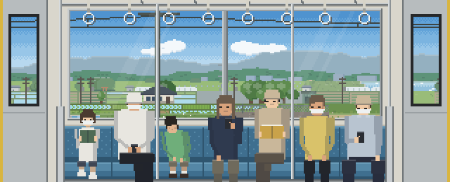
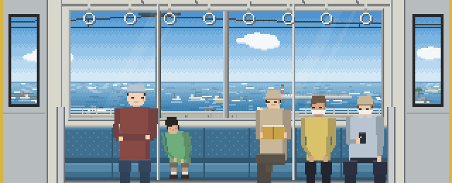
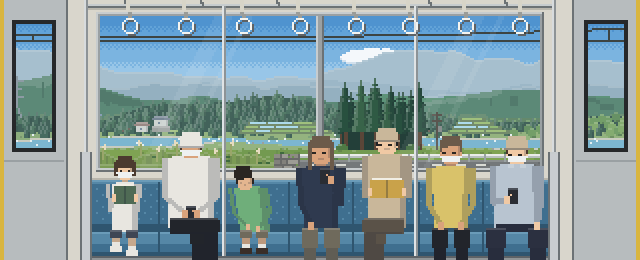
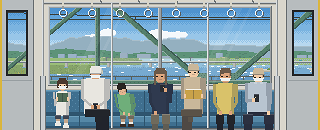
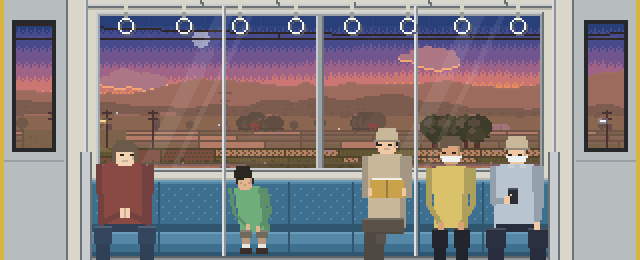
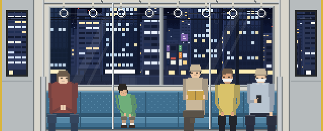
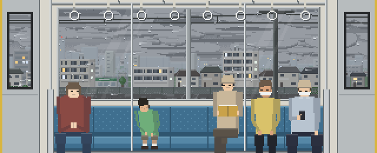

# ドット車窓

電車のロングシートの中央に座って、向かいの窓を流れるランダム生成の景色をぼんやり眺めるだけのサイトです。

**▶ https://kohaniro.github.io/dot-shasou/**



- すべてコードで描いたドット絵（画像素材なし）。HTML + Canvas 2D + 素の JavaScript（ES Modules）。
- 都心・住宅街・郊外・田園・山間・海沿いが続き、駅・トンネル・橋・高架が現れます。
- 音（走行音・継ぎ目・ドアチャイムなど）はブラウザ上で合成しています。
- 絵柄の切り替え、乗客の表示の切り替え、音量の調整ができます。
- 走るにつれて時間帯（朝・昼・夕・夜）と天気（晴れ・曇り・雨・雪）が移り変わります。
- URL の末尾に `#line-1234` のように付けると、同じ路線（景色）を再現できます。
- 乗っている車両（座席の色・模様、つり革の形など）も路線ごとに変わります。
- 駅名は生成された架空のもので、実在の駅・地名とは関係ありません。

## いろいろな景色

| | | |
|:-:|:-:|:-:|
| <br>海沿い | <br>山間 | <br>鉄橋 |
| <br>夕焼けの田園 | <br>夜の都心 | <br>雨の住宅街 |

画像はすべて路線 `#line-1234` のものです。

## 制作について

- コードはすべて LLM（Claude の Fable・Opus・Sonnet など）が生成し、人間が画面を見て確認しながら進めています。
- まだ調整が足りない部分があります（写実以外の絵柄の色、音のバランス、乗客の動きなど）。

## ローカルで動かす

ES Modules を使っているため、`file://` では開けません。簡易サーバー経由で開いてください。

```
node .claude/skills/serve/serve.mjs --detach
```

→ http://localhost:8000/

このリポジトリを Claude Code で開くと、作業終了時（Stop フック）に確認用の静的サーバーが自動で起動します（`.claude/settings.json` の `hooks`）。

- 起動するのは `node .claude/skills/serve/serve.mjs --hook` です。ポート 8000 がすでに使われていれば何もせず、使われていないときだけ裏で起動します。
- `127.0.0.1` だけで待ち受けるので、外部には公開されません。リポジトリ直下のファイルを配信し、`.git` や `.claude` など `.` で始まるパスは配信しません。
- ポートは環境変数 `SHASOU_PORT` で変えられます。
- 止めるには `node .claude/skills/serve/serve.mjs --stop` を実行します。
- 自動起動が不要なら、`.claude/settings.json` の `hooks` を削除してください。

## デバッグ機能

操作の行の「デバッグ」ボタンを押すと、その下にデバッグ用の表示が出ます（もう一度押すと隠れます）。URL に `?debug` を付けて開いても最初から出ます（例: `http://localhost:8000/?debug#line-1234`）。ボタンでの出し入れに合わせて URL の `?debug` も付け外しするので、再読み込みしても同じ状態です。

- **速度**: 停止 / ×1 / ×2 / ×4 / ×8 / ×16。早送り・停止の間は音を止めます。停止中も描画は続くので、止めたまま移動して見比べられます。
- **移動**: 次のバイオーム / 次の駅の手前（止まる 15 秒前の減速中）/ 次のトンネル / 次の橋 / 次の高架へ移動します。
- **時間帯・天気**: 時間帯（朝焼け・昼・夕焼け・夜）と天気（晴・曇・雨・雪）の固定、次の夕方 / 次の朝 / 次の天気の変わり目へ移動します。
- **状態の表示**（日本語）: 走行距離、バイオームの重み（都心・住宅街など）、進行の状態（巡航・減速・停車・発車）、時速と目標速度、高架、次の駅、トンネル・橋・踏切・至近の建物・対向列車までの距離、乗客の人数、時刻と雲・雨・雪、色調の段階。

隠すと、速度は ×1、時間帯・天気の固定は自動に戻ります。

## ライセンス

著作権は作者に帰属します（All rights reserved）。

- 画面録画・スクリーンショットの投稿や配信は、営利目的・収益化を含めて自由です（連絡不要）。サイト名と URL を添えていただけると嬉しいです（任意）。
- ソースコード・画像・音声そのものの再配布・転載や、改変物の公開はご遠慮ください。
- 現状のまま提供しており、利用によって生じた損害について作者は責任を負いません。

詳しくは [LICENSE](LICENSE) をご覧ください。
